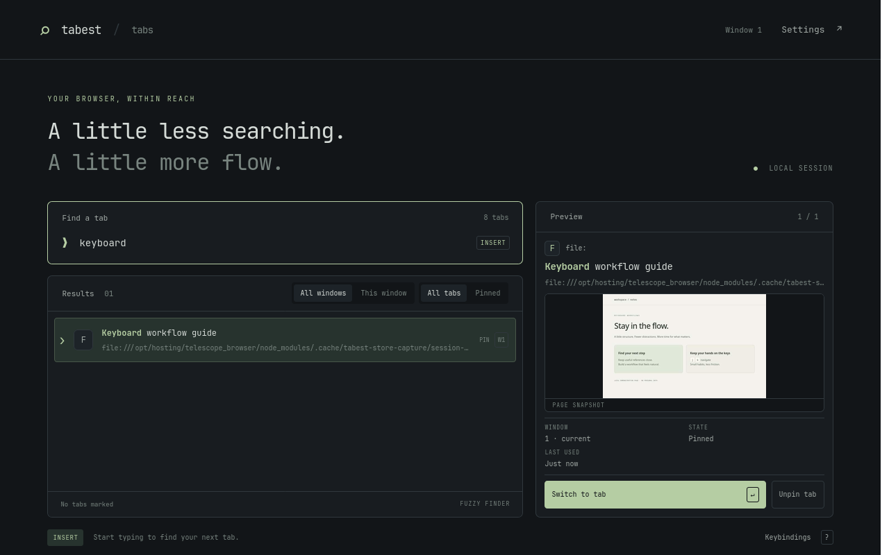
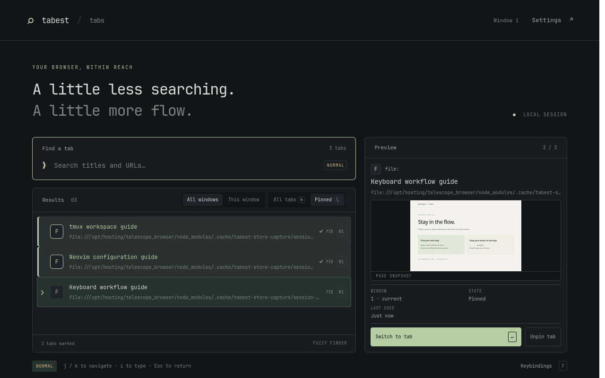
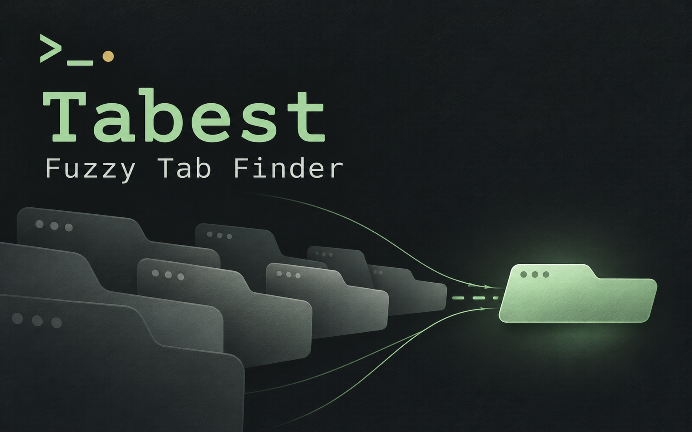

# Tabest — Fuzzy Tab Finder

<p align="center">
  <a href="docs/store-assets/README.md">
    
  </a>
</p>

**Find your tabs. Keep your flow.**

A Telescope-inspired tab finder for Firefox and Zen, with fuzzy search,
Vim-style navigation, and page previews. Open a dedicated search tab, type a few
letters, and switch to the page you need without reaching for the mouse.

[Screenshots](#see-it-in-action) · [Quick start](#quick-start) ·
[Keybindings](#default-keys) · [Privacy](PRIVACY.md) · [MIT license](LICENSE)

**Release status:** version **0.2.4** has been submitted to Firefox Add-ons and is
awaiting review, as reported by the maintainer. A public installation link will
be added after publication. Until then, use the development installation below.

## What you can do

- Search open tab titles and URLs with fuzzy matching and multiple search terms.
- Move between Insert and Normal modes, with customizable keybindings.
- Preview available page snapshots and tab details without activating the target.
- Search all browser windows or only the current one.
- Switch between all tabs and pinned tabs independently of window scope.
- Mark several tabs, close a selection, or pin and unpin individual tabs.
- Choose dark, light, or system appearance.

Tabs are ranked by match quality and recency. Pinned tabs do not receive a hidden
ranking boost: use the Pinned filter when you want to search only among them.
No account, analytics, remote search service, or cloud backend is used.

## See it in action

### Find a tab before you leave your current one

Search titles and URLs, see matching text highlighted, and inspect an available
page snapshot before switching.

[](docs/store-assets/screenshots/01-fuzzy-search.png)

### Keep pinned tabs within reach

Press **Escape** for Normal mode, **l** to show pinned tabs, and **Tab** to mark
results. The active row and marked tabs have distinct visual states.

[](docs/store-assets/screenshots/02-pinned-and-marks.png)

These are actual extension screenshots captured in an isolated Zen instance at
1280 × 800, using synthetic local pages rather than personal browsing data.
The animated icon above is a branding animation, not a recording of the workflow.

## Quick start

1. Open the picker with **Ctrl+Shift+Space** or the extension's toolbar button.
2. Start typing in Insert mode to narrow the results.
3. Navigate with **Ctrl+n / Ctrl+p** or the arrow keys; press **Enter** to switch.
4. Press **Escape** for Normal mode, then **Escape** again to close the picker.

The global shortcut is a suggested browser binding. Change it under the browser's
**Manage Extension Shortcuts** settings if it conflicts with a Zen command, a mod,
another extension, or an operating-system shortcut.

## Default keys

| Action | Insert | Normal |
| --- | --- | --- |
| Next / previous result | Ctrl+n / Ctrl+p, Ctrl+j / Ctrl+k, arrows | j / k, arrows |
| Switch to selected tab | Enter | Enter |
| Enter Normal / Insert mode | Escape | i or / |
| Close picker | Ctrl+c | Escape or Ctrl+c |
| Mark and move next / previous | Tab / Shift+Tab | Tab / Shift+Tab |
| Close marked tabs, or selected tab | — | dd |
| Pin / unpin selected tab | — | p |
| Show all / pinned tabs | — | h / l |
| Toggle all windows / current window | — | w |
| First / last result | — | gg / G, Home / End |
| Show keybindings | Ctrl+/ | ? |

Settings includes the editable Insert/Normal keymap. The tab filter is remembered
between openings. Changing filters preserves the query and the active result
where possible; marks hidden by a scope or tab-filter change are cleared.

## Privacy and permissions

Search runs locally. Tab titles, URLs, and available page snapshots are processed
inside the browser, not sent to a search service. Preview images are cached in
extension memory; they are not written to persistent extension storage.

- **tabs:** read tab metadata and manage tab selection, closing, and pinning.
- **storage:** remember preferences and browser-session bookkeeping.
- **Access to all websites:** required by the Firefox API used to capture page
  previews. Without the permission, preview shows a placeholder.

See the [privacy notice](PRIVACY.md) for storage details and limitations.

## Development installation

See [BUILDING.md](BUILDING.md) for environment requirements and caveats.

```sh
npm ci
npm test
npm run build
```

In a separate browser profile, open `about:debugging#/runtime/this-firefox`, choose
**Load Temporary Add-on**, and select `dist/manifest.json`. Temporary installation
is for development, not a substitute for the signed public release.

`npm run dev` watches source changes and rebuilds the extension. Reload the add-on
in `about:debugging` after rebuilding. `npm run preview` serves a sample-data demo;
it cannot manipulate real browser tabs.

## Compatibility and limitations

- The manifest targets **Firefox desktop 140+**. Automated native checks currently
  use an isolated Zen installation on Linux; a release must also be tested in
  standard Firefox. Android, Chromium, and Safari are not claimed as supported.
- Protected pages, sleeping tabs, missing permissions, or capture failures may
  prevent a screenshot. On narrow screens, the preview panel is hidden.
- The browser controls which pages and files an extension may access.
- Private-window access must be allowed by the user. The implementation separates
  private and regular tab results and previews; private-window checks remain part
  of the release checklist.

## Contributing and reporting issues

Read [CONTRIBUTING.md](CONTRIBUTING.md). When reporting a bug, include browser and
OS versions, exact reproduction steps, and expected versus actual behavior. Use
synthetic pages and remove personal information from screenshots and logs.

Agent instructions are in [AGENTS.md](AGENTS.md) and [CLAUDE.md](CLAUDE.md), with
shared rules under [.agents/](.agents/AGENTS.md).

## Project status and publication

- [Changelog](CHANGELOG.md)
- [GitHub profile copy](docs/github-description.md)
- [Firefox Add-ons listing copy](docs/amo-listing.md)
- [Reviewer notes](docs/reviewer-notes.md)
- [Release checklist](docs/release-checklist.md)
- [Screenshots, icons, and asset reproduction instructions](docs/store-assets/README.md)

<details>
<summary>Brand artwork and image downloads</summary>

[](docs/store-assets/tabest-promo.png)

Promotional artwork generated with AI; not a screenshot of the interface.

[PNG icon, 128 × 128](docs/store-assets/tabest-icon-128.png) ·
[PNG icon, 1024 × 1024](docs/store-assets/tabest-icon-1024.png) ·
[Animated GIF icon](docs/store-assets/tabest-icon-animated.gif) ·
[Promotional image](docs/store-assets/tabest-promo.png)

</details>

Inspired by the interaction model of Telescope for Neovim. Not an official
Telescope, Neovim, Mozilla, or Zen project. The public name is
**Tabest — Fuzzy Tab Finder**. The store link will be added when the release is
public; no placeholder installation or support URLs are used.

The existing add-on ID and legacy local preference keys are intentionally retained
so renaming the product does not reset an existing installation's settings.
They are compatibility identifiers, not the public product name.

## License

[MIT](LICENSE). Use, modify, and distribute the code, including commercially,
provided the copyright and permission notices are retained. The software is
provided "as is", without warranties, with the liability disclaimer in the license.
Third-party components retain their own licenses.
